<div align="center">

# DevStory

**A social network for developers: blog, ask, follow and chat.**

[](https://github.com/cdrrazan/socialnetwork/actions/workflows/ci.yml)


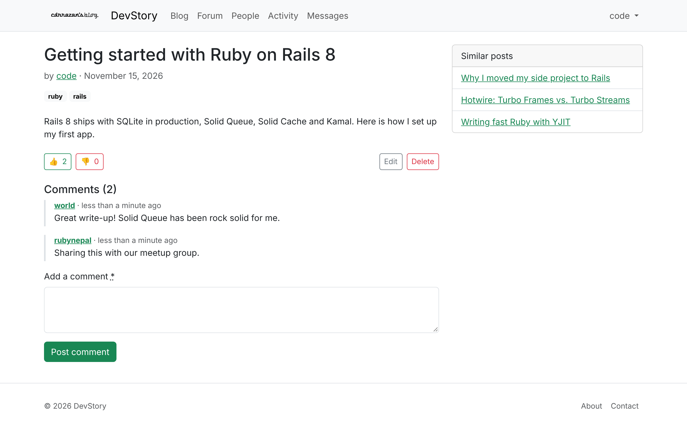

</div>

DevStory (originally *Coders Sanjal*) began in 2017 as a final-year project:
a meeting point for developers, mostly in Nepal, to discuss, share ideas and
collaborate. In 2026 it was rebuilt on **Ruby 4.0** and **Rails 8.1**. See the
[changelog](CHANGELOG.md) for everything that changed.

## Contents

- [Features](#features)
- [Screenshots](#screenshots)
- [Tech stack](#tech-stack)
- [Architecture](#architecture)
- [Getting started](#getting-started)
- [Configuration](#configuration)
- [Testing and quality](#testing-and-quality)
- [Docker](#docker)
- [Deployment](#deployment)
- [Routes](#routes)
- [Project layout](#project-layout)
- [Command cheat sheet](#command-cheat-sheet)
- [Further reading](#further-reading)
- [Contributing](#contributing)

## Features

| | Feature | Details |
|:-:|---|---|
| ✍️ | **Blog** | Write posts in the Trix rich text editor, tag them, filter by tag, vote 👍/👎 and comment. Post HTML is sanitized before it is shown. |
| 🔎 | **Similar posts** | Each post suggests related posts using TF-IDF and cosine similarity ([how it works](doc/recommendations.md)). |
| 💬 | **Forum** | Ask questions and answer them. Anyone can read; members can post. A JSON API is included. |
| 🤝 | **Follow people** | Search members by username or email and follow or unfollow them. |
| 📰 | **Activity feed** | See when people you follow publish posts or comment. |
| ✉️ | **Private messages** | One-to-one conversations that auto-scroll to the newest message. |
| 🧑‍💻 | **Profiles** | Usernames, profile pictures (Active Storage), and your posts, questions, followers and following. |
| 🛡️ | **Moderation** | Authors manage their own content; moderators can remove anyone's. Enforced by Pundit policies. |
| 🛠️ | **Admin panel** | ActiveAdmin at `/admin`: manage members, posts, questions and answers, draft and publish announcements, grant moderator rights. |
| 🤖 | **Spam protection** | Optional Google reCAPTCHA on new posts, switched on by setting two environment variables. |
| 📱 | **Responsive** | Bootstrap 5 layout that works on phones. |

## Screenshots

<table>
  <tr>
    <td width="50%"><br><sub><b>Landing page</b> for visitors</sub></td>
    <td width="50%">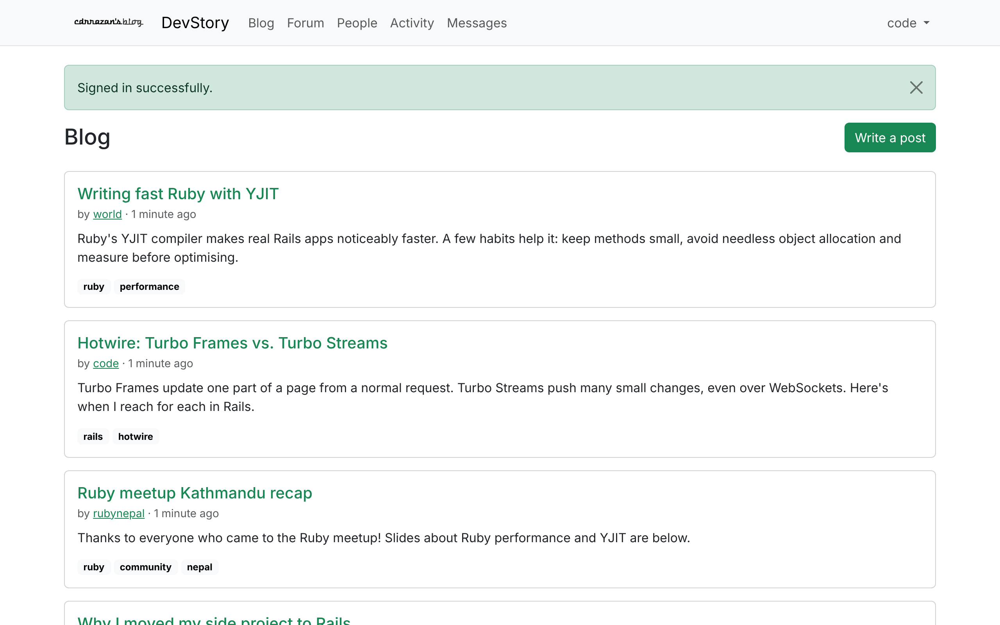<br><sub><b>Blog</b>: latest posts with tags</sub></td>
  </tr>
  <tr>
    <td>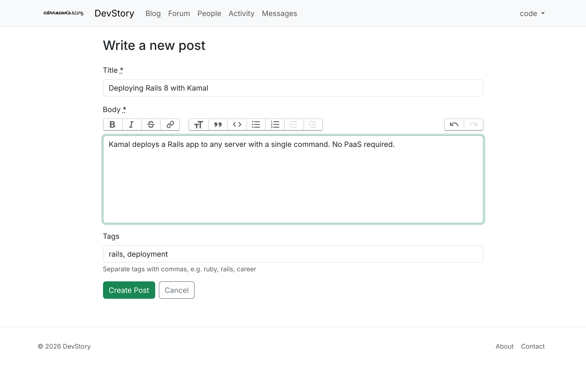<br><sub><b>Rich text editor</b> (Trix) with tags</sub></td>
    <td>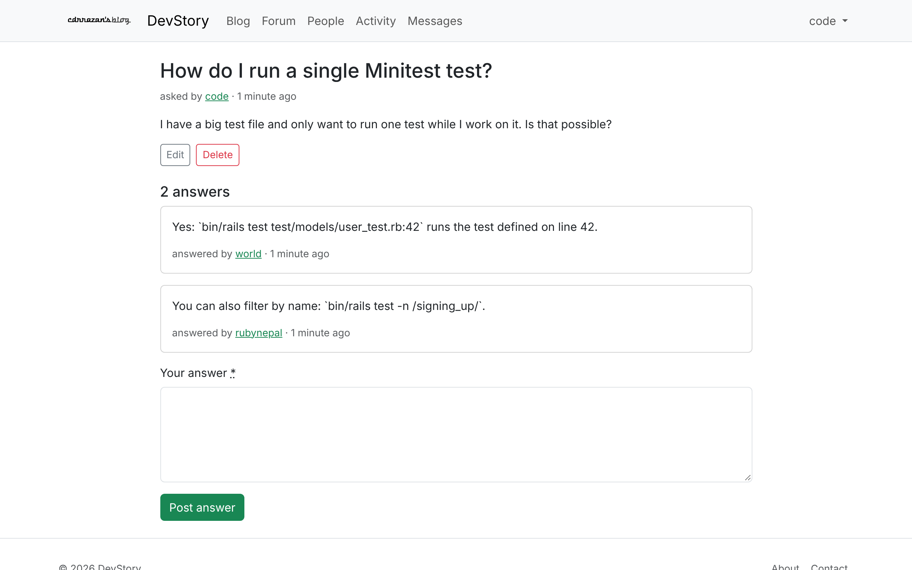<br><sub><b>Forum question</b> with answers</sub></td>
  </tr>
  <tr>
    <td>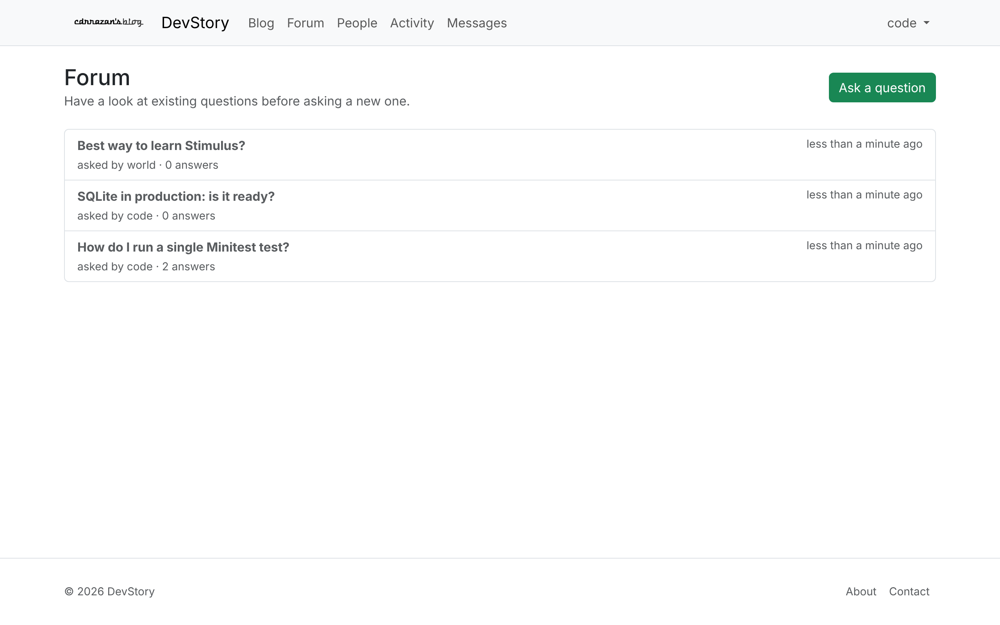<br><sub><b>Forum</b>: newest questions first</sub></td>
    <td>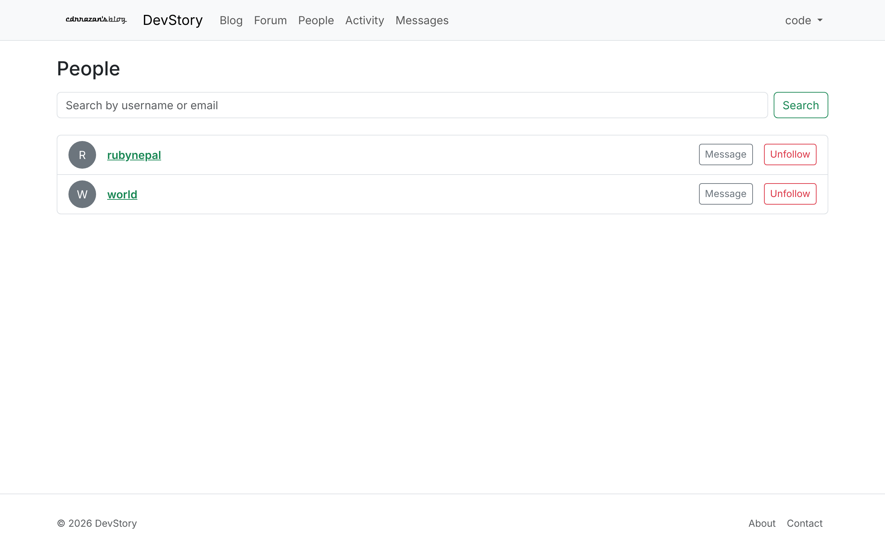<br><sub><b>People</b>: search, follow and message</sub></td>
  </tr>
  <tr>
    <td>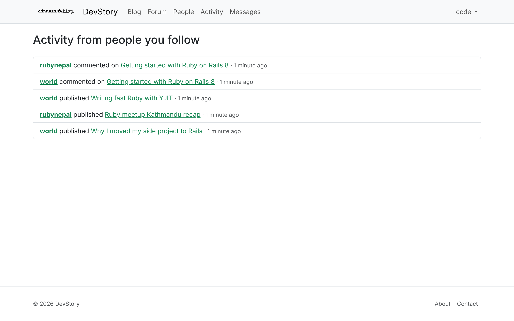<br><sub><b>Activity feed</b> from people you follow</sub></td>
    <td>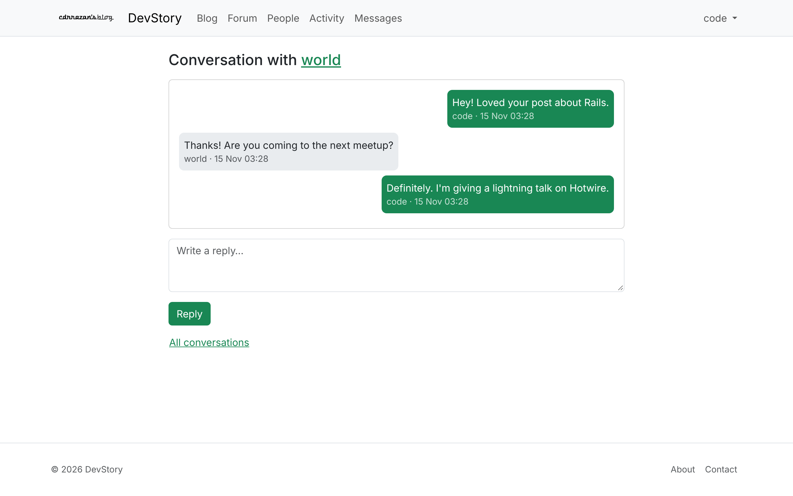<br><sub><b>Private messages</b></sub></td>
  </tr>
  <tr>
    <td><br><sub><b>Your profile</b></sub></td>
    <td><br><sub><b>Admin dashboard</b> (ActiveAdmin)</sub></td>
  </tr>
  <tr>
    <td><br><sub><b>Sign up</b></sub></td>
    <td align="center"><br><sub><b>On a phone</b></sub></td>
  </tr>
</table>

Screenshots are generated from the seed data by
[`script/screenshots.js`](script/screenshots.js).

## Tech stack

| Layer | Technology | Notes |
|---|---|---|
| Language | Ruby 4.0 | Any Ruby ≥ 3.3 works; CI tests 3.3, 3.4 and 4.0. |
| Framework | Rails 8.1 | `load_defaults 8.1`. |
| Database | SQLite 3 | Development, test and production. |
| Background jobs | Solid Queue | Separate SQLite database in production. |
| Cache | Solid Cache | Separate SQLite database in production. |
| WebSockets | Solid Cable | Separate SQLite database in production. |
| Web server | Puma | Can run Solid Queue in-process (`SOLID_QUEUE_IN_PUMA`). |
| Front end | Turbo, Stimulus, import maps | No bundler and no Node.js. |
| Styling | Bootstrap 5.3, Dart Sass, Sprockets | Sprockets is kept for ActiveAdmin and the bootstrap gem. |
| Editor | Trix | Shipped by the `action_text-trix` gem. |
| Accounts | Devise 5 | Members and admins are separate models. |
| Authorization | Pundit | Policies in `app/policies`. |
| Uploads | Active Storage + libvips | Profile pictures with thumbnail/medium/large variants. |
| Admin | ActiveAdmin 3.5 | Ransack 4 search allowlists. |
| Social | acts_as_votable, acts-as-taggable-on, public_activity | Votes, tags and the activity feed. |
| Recommendations | tf-idf-similarity | See [doc/recommendations.md](doc/recommendations.md). |
| Tests | Minitest, Capybara, Cuprite | Cuprite drives Chrome directly; no chromedriver. |
| Quality | RuboCop (rails-omakase), Brakeman, bundler-audit, importmap audit | Run by `bin/ci` and GitHub Actions. |

## Architecture

### How a request flows

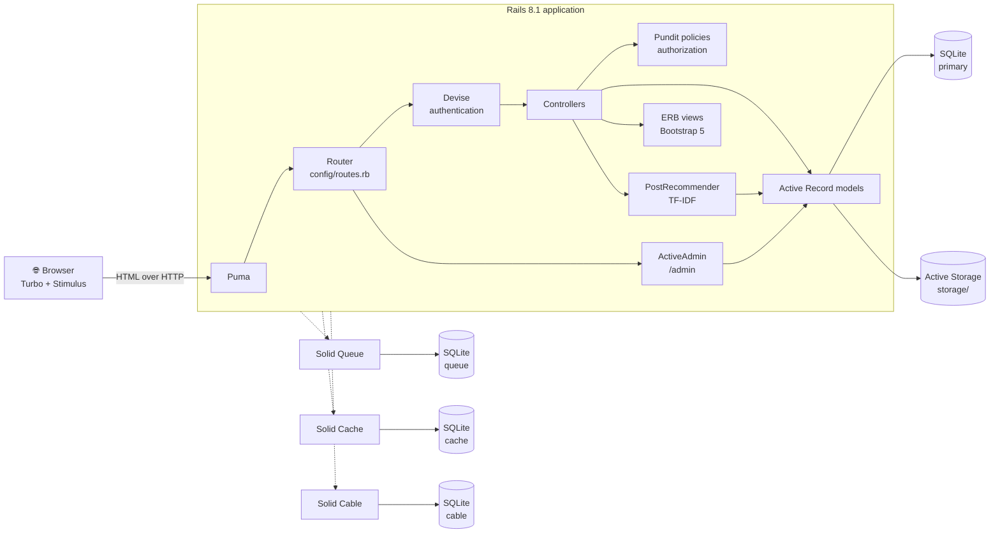

### Publishing a post

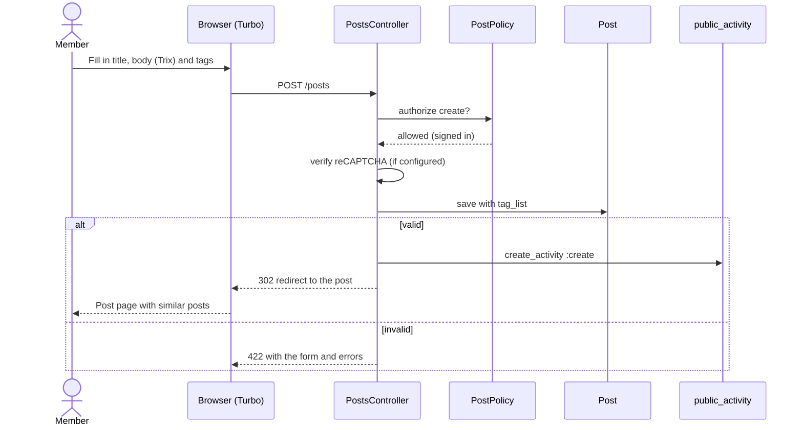

### Data model

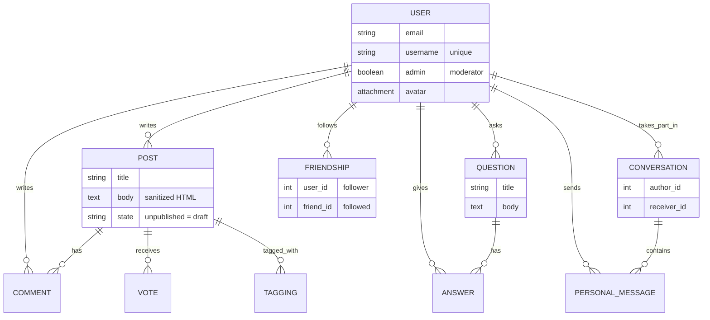

[doc/architecture.md](doc/architecture.md) has the full data model, including
the tables that gems add.

### Who can do what

| Resource | Read | Create | Edit | Delete |
|---|---|---|---|---|
| Post | Members (drafts: author and moderators) | Members | Author, moderators | Author, moderators |
| Comment | With its post | Members | Author | Author, moderators |
| Question | Everyone | Members | Author, moderators | Author, moderators |
| Answer | Everyone | Members | n/a | Author, moderators |
| Conversation | The two participants | Members | n/a | n/a |
| Admin panel | Admin users only (separate login) | | | |

A *moderator* is a member whose **admin** flag has been switched on in the
admin panel.

### Similar posts in one picture

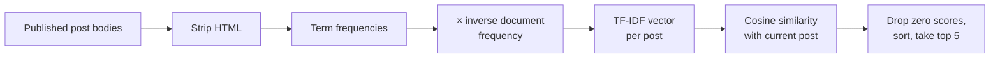

## Getting started

### Requirements

| Tool | Version | Why |
|---|---|---|
| Ruby | 4.0 (≥ 3.3) | See [`.ruby-version`](.ruby-version). |
| SQLite | 3 | The database. |
| libvips | any recent | Resizes profile pictures (`brew install vips` / `apt install libvips`). |
| Chrome or Chromium | any recent | System tests only. |

You don't need Node.js, Yarn, MySQL or Redis.

### Setup

```bash
git clone https://github.com/cdrrazan/socialnetwork.git
cd socialnetwork
bin/setup
```

`bin/setup` installs the gems, creates the database, loads demo content from
[`db/seeds.rb`](db/seeds.rb) and starts the server at
**http://localhost:3000**. Start it again later with `bin/dev`.

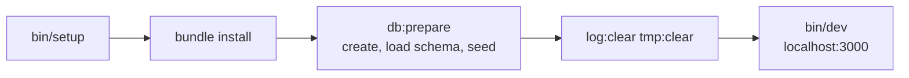

### Demo accounts

The seeds create these accounts, all with the password **`password`**:

| Account | Where to log in | Notes |
|---|---|---|
| `code@example.com` | http://localhost:3000/users/sign_in | Follows the other two members and has a conversation with `world`. |
| `world@example.com` | Same | |
| `rubynepal@example.com` | Same | |
| `admin@example.com` | http://localhost:3000/admin | Admin panel. |

Seeds are idempotent: run `bin/rails db:seed` at any time to restore them.

## Configuration

Settings come from environment variables. In development you can put them in
a `.env` file (copy [`.env.example`](.env.example)); it is ignored by git.

| Variable | Default | Purpose |
|---|---|---|
| `RECAPTCHA_SITE_KEY`, `RECAPTCHA_SECRET_KEY` | unset | Turn on reCAPTCHA for new posts. Without them it is off. |
| `SECRET_KEY_BASE` | dev: auto-generated | **Required in production.** Generate with `bin/rails secret`. |
| `APP_HOST` | `example.com` | Host name used in links in emails (production). |
| `FORCE_SSL` | `true` | Set to `false` to serve production over plain HTTP. |
| `SOLID_QUEUE_IN_PUMA` | unset | Run background jobs inside Puma. |
| `RAILS_MAX_THREADS` | `3` (DB pool: `5`) | Puma threads per process; also sets the database connection pool. |
| `WEB_CONCURRENCY` | unset | Number of Puma worker processes. |
| `PORT` | `3000` | Port Puma listens on. |
| `RAILS_LOG_LEVEL` | `info` | Production log level. |

## Testing and quality

```bash
bin/rails test          # 88 unit, policy, service, controller and integration tests
bin/rails test:system   # 3 browser tests (needs Chrome/Chromium)
bin/ci                  # everything below, in order
```

| Check | Command | What it covers |
|---|---|---|
| 🧪 Tests | `bin/rails test` | Models, Pundit policies, `PostRecommender`, every controller, ActiveAdmin and sign-up. |
| 🖥️ System tests | `bin/rails test:system` | Logging in, writing a post in Trix, Turbo confirm dialogs, following and messaging. |
| 🎨 Style | `bin/rubocop` | rubocop-rails-omakase. |
| 🔐 Code security | `bin/brakeman` | Static analysis for Rails vulnerabilities. |
| 📦 Gem security | `bin/bundler-audit` | Known CVEs in gems. |
| 📦 JS security | `bin/importmap audit` | Known CVEs in pinned JavaScript packages. |
| 🌱 Seeds | `RAILS_ENV=test bin/rails db:seed:replant` | The seed file still runs. |

System-test options: `BROWSER_PATH=/path/to/chrome` picks the browser and
`HEADLESS=false` shows it while the tests run.

### Continuous integration

GitHub Actions ([`.github/workflows/ci.yml`](.github/workflows/ci.yml)) runs
on every push to `master`/`main` and on every pull request. Dependabot keeps
gems and actions up to date.

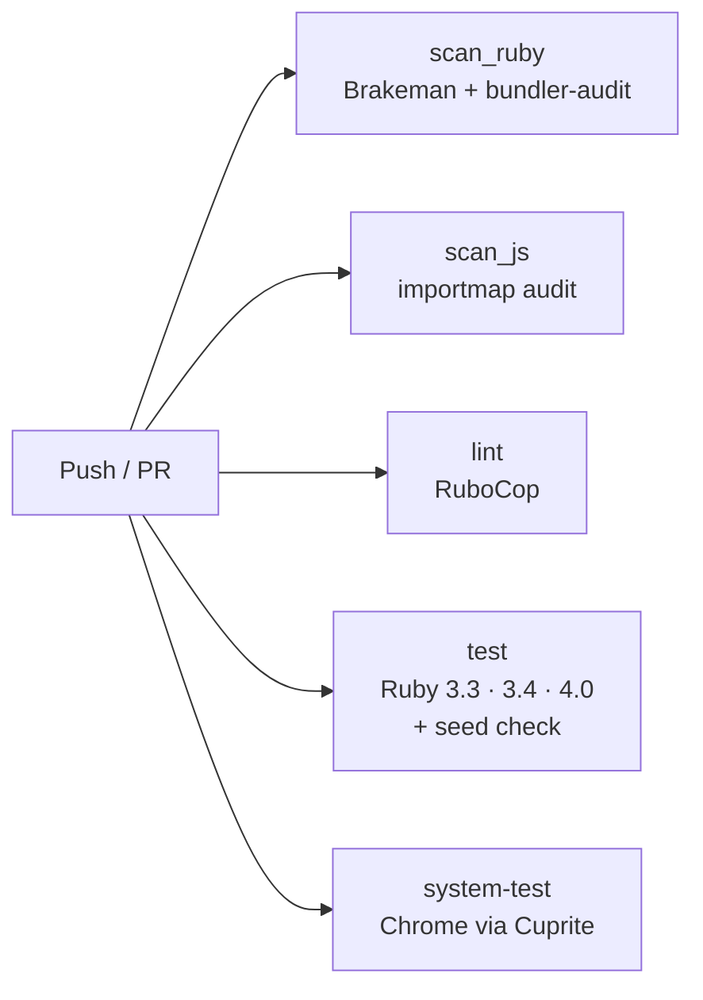

## Docker

The [`Dockerfile`](Dockerfile) builds a production image: multi-stage build,
Ruby 4.0 slim, jemalloc, libvips, a non-root user, precompiled assets and
bootsnap. To run it locally with [`docker-compose.yml`](docker-compose.yml):

```bash
SECRET_KEY_BASE=$(bin/rails secret) docker compose up --build
```

Open http://localhost:3000. Data is kept in the `storage` volume. To add the
demo content:

```bash
docker compose exec web bin/rails db:seed
```

## Deployment

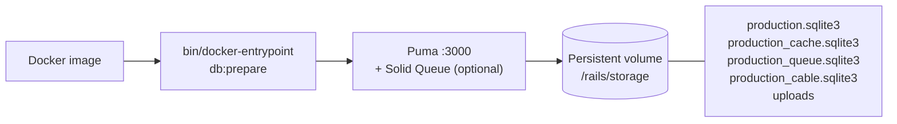

This is a standard Rails 8 app, so it runs on any container host or server
with Ruby. Checklist:

1. **Mount persistent storage** at `storage/` (`/rails/storage` in the image).
   It holds all four SQLite databases and the uploaded files.
2. **Set `SECRET_KEY_BASE`** and **`APP_HOST`**. Set `FORCE_SSL=false` only if
   TLS is not terminated in front of the app.
3. **Migrations** run automatically when the container starts
   (`bin/rails db:prepare`).
4. **Background jobs**: run `bin/jobs` as a second process, or set
   `SOLID_QUEUE_IN_PUMA=true` on a single server.
5. **Create the first admin** from a console:
   ```ruby
   AdminUser.create!(email: "you@example.com", password: "a-long-password")
   ```
6. **Health check**: `GET /up` returns 200 when the app has booted.

Upgrading an installation from the 2017 version? Read
[doc/UPGRADING.md](doc/UPGRADING.md) first.

## Routes

| Path | Page | Access |
|---|---|---|
| `/` | Landing page, or the blog when signed in | Everyone |
| `/about`, `/contact` | Static pages | Everyone |
| `/users/sign_up`, `/users/sign_in`, `/users/password/new` | Devise accounts | Everyone |
| `/users/edit` | Edit profile, password and picture | Members |
| `/posts`, `/posts?tag=ruby` | Blog, optionally filtered by tag | Members |
| `/posts/new`, `/posts/:id`, `/posts/:id/edit` | Write, read and edit posts | Members |
| `PUT /posts/:id/like`, `PUT /posts/:id/dislike` | Vote | Members |
| `/posts/:post_id/comments` | Add, edit and delete comments | Members |
| `/questions`, `/questions/:id` (also `.json`) | Forum | Everyone |
| `/questions/new`, `/questions/:id/edit` | Ask and edit questions | Members |
| `/questions/:question_id/answers` | Answer and delete answers | Members |
| `/users`, `/users/:id` | People search and profiles | Members |
| `/my_friends` | Following and followers | Members |
| `POST /friendships`, `DELETE /friendships/:user_id` | Follow and unfollow | Members |
| `/activities` | Activity feed | Members |
| `/conversations`, `/conversations/:id` | Private messages | Participants |
| `/personal_messages/new?receiver_id=:id` | Start a conversation | Members |
| `/profile`, `/settings` | Your profile; delete your account | Members |
| `/admin` | ActiveAdmin | Admin users |
| `/up` | Health check | Everyone |

Run `bin/rails routes` for the full list.

## Project layout

```text
app/
├── admin/            ActiveAdmin resources and dashboard
├── assets/           Sass (application.scss, active_admin.scss) and images
├── controllers/      Blog, forum, people, messaging, activity and static pages
├── javascript/       Import-map entry point and Stimulus controllers
├── models/           Active Record models
├── policies/         Pundit authorization policies
├── services/         PostRecommender (TF-IDF similar posts)
└── views/            ERB templates (Bootstrap 5)
config/               Routes, environments, import map, Solid configs
db/
├── migrate/          Migrations from 2017 to today
├── schema.rb         Current schema
└── seeds.rb          Demo data
doc/
├── architecture.md   Data model, request flow, authorization
├── recommendations.md How "similar posts" works
├── UPGRADING.md      Migrating a 2017 installation
└── screenshots/      Images used in this README
script/screenshots.js Regenerates the screenshots
test/                 Minitest: models, policies, services, controllers,
                      integration and system tests
```

## Command cheat sheet

| Task | Command |
|---|---|
| Set up and start | `bin/setup` |
| Start the server | `bin/dev` |
| Rails console | `bin/rails console` |
| Reload demo data | `bin/rails db:seed` |
| Reset the database | `bin/rails db:reset` |
| Run migrations | `bin/rails db:migrate` |
| Run one test file or line | `bin/rails test test/models/user_test.rb:12` |
| Run everything CI runs | `bin/ci` |
| Auto-fix style | `bin/rubocop -a` |
| Background jobs (production) | `bin/jobs` |
| Pin a JavaScript package | `bin/importmap pin <package>` |
| Regenerate screenshots | `node script/screenshots.js` |

## Further reading

- [doc/architecture.md](doc/architecture.md): data model, request flow,
  authorization and background jobs
- [doc/recommendations.md](doc/recommendations.md): the TF-IDF and cosine
  similarity maths behind "similar posts"
- [doc/UPGRADING.md](doc/UPGRADING.md): moving a 2017 MySQL installation to
  this version
- [CHANGELOG.md](CHANGELOG.md): what changed in the 2026 rebuild

## Contributing

1. Fork the repository and create a branch.
2. Make your change, with tests.
3. Run `bin/ci` (or at least `bin/rails test` and `bin/rubocop`).
4. Open a pull request. CI must pass.

If you change the UI, regenerate the screenshots with
`node script/screenshots.js`.

## Credits

Built in 2017 by the DevStory / Coders Sanjal team as a final-year project, and
modernised in 2026. See the git history for all contributors.
