<div align="center">

# DevStory

**A social network for developers: blog, ask, follow and chat.**

[](https://github.com/cdrrazan/socialnetwork/actions/workflows/ci.yml)


</div>

DevStory (originally *Coders Sanjal*) began in 2017 as a final-year project:
a meeting point for developers, mostly in Nepal, to discuss, share ideas and
collaborate. In 2026 it was rebuilt on **Ruby 4.0**, **Rails 8.1** and
**MySQL 8**, with an RSpec suite that covers every line and branch. See the
[changelog](CHANGELOG.md) for everything that changed.

## Contents

- [Features](#features)
- [Screenshots](#screenshots)
- [Tech stack](#tech-stack)
- [Architecture](#architecture)
- [Database](#database)
- [Getting started](#getting-started)
- [Configuration](#configuration)
- [Testing and quality](#testing-and-quality)
- [Docker](#docker)
- [Deployment](#deployment)
- [Routes](#routes)
- [Project layout](#project-layout)
- [Command cheat sheet](#command-cheat-sheet)
- [Further reading](#further-reading)
- [Contributing](#contributing)

## Features

| | Feature | Details |
|:-:|---|---|
| ✍️ | **Blog** | Write posts in the Trix rich text editor, tag them, filter by tag, sort by newest or top-voted, vote 👍/👎 and comment. Post HTML is sanitized before it is shown. |
| 🔎 | **Similar posts** | Each post suggests related posts using TF-IDF and cosine similarity ([how it works](doc/recommendations.md)). |
| 💬 | **Forum** | Ask questions and answer them. Anyone can read; members can post. A JSON API is included. |
| 🤝 | **Follow people** | Search members by username or email and follow or unfollow them. |
| 📰 | **Activity feed** | See when people you follow publish posts or comment. |
| ✉️ | **Private messages** | One-to-one conversations that auto-scroll to the newest message. |
| 🧑‍💻 | **Profiles** | Usernames, profile pictures (Active Storage), and your posts, questions, followers and following. |
| 🛡️ | **Moderation** | Authors manage their own content; moderators can remove anyone's. Enforced by Pundit policies. |
| 🛠️ | **Admin panel** | ActiveAdmin at `/admin`: manage members, posts, questions and answers, draft and publish announcements, grant moderator rights. |
| 🤖 | **Spam protection** | Optional Google reCAPTCHA on new posts, switched on by setting two environment variables. |
| 📱 | **Responsive** | Bootstrap 5 layout that works on phones. |
| 🗄️ | **Data integrity** | MySQL foreign keys, NOT NULL and CHECK constraints back up every model validation, and `bin/rails data:audit` finds rows that break the rules. |

## Screenshots

<table>
  <tr>
    <td width="50%">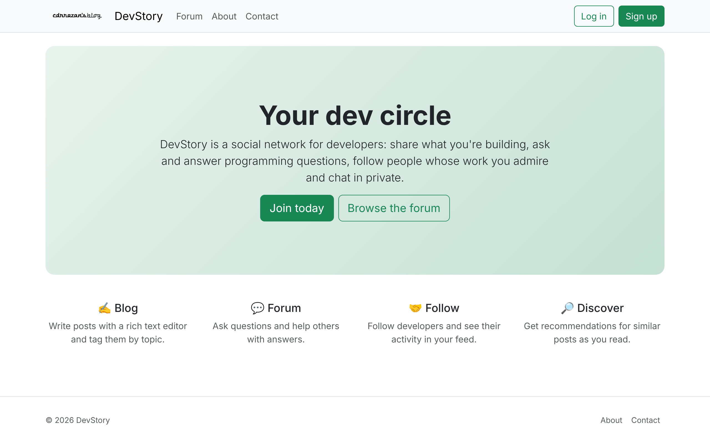<br><sub><b>Landing page</b> for visitors</sub></td>
    <td width="50%"><br><sub><b>Blog</b>: latest posts with tags</sub></td>
  </tr>
  <tr>
    <td><br><sub><b>Rich text editor</b> (Trix) with tags</sub></td>
    <td><br><sub><b>Forum question</b> with answers</sub></td>
  </tr>
  <tr>
    <td><br><sub><b>Forum</b>: newest questions first</sub></td>
    <td><br><sub><b>People</b>: search, follow and message</sub></td>
  </tr>
  <tr>
    <td><br><sub><b>Activity feed</b> from people you follow</sub></td>
    <td><br><sub><b>Private messages</b></sub></td>
  </tr>
  <tr>
    <td>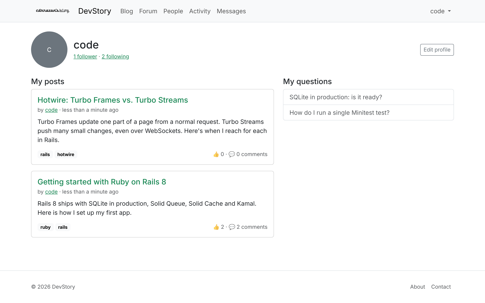<br><sub><b>Your profile</b></sub></td>
    <td>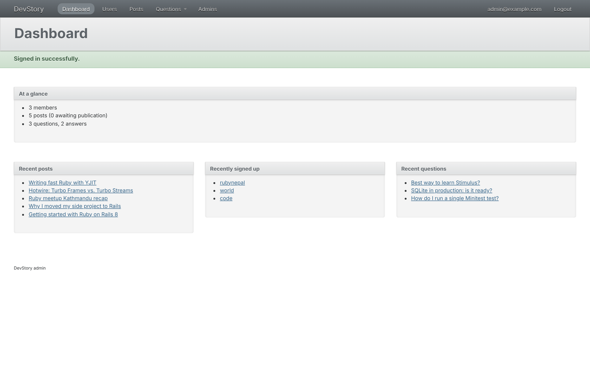<br><sub><b>Admin dashboard</b> (ActiveAdmin)</sub></td>
  </tr>
  <tr>
    <td>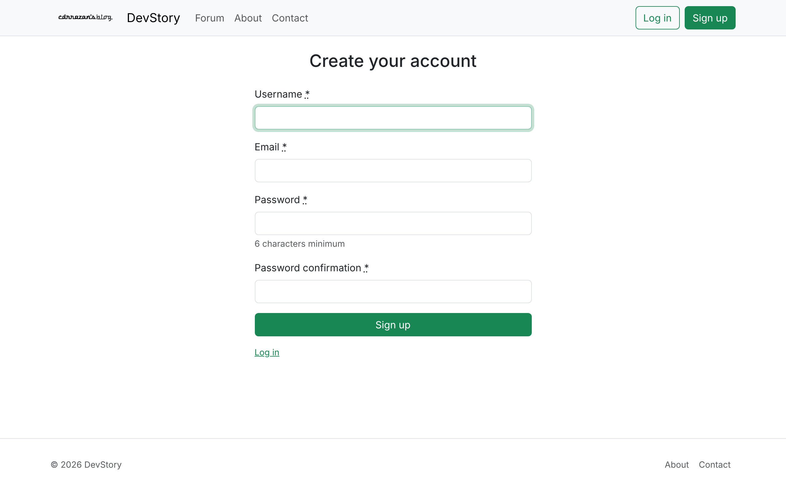<br><sub><b>Sign up</b></sub></td>
    <td align="center">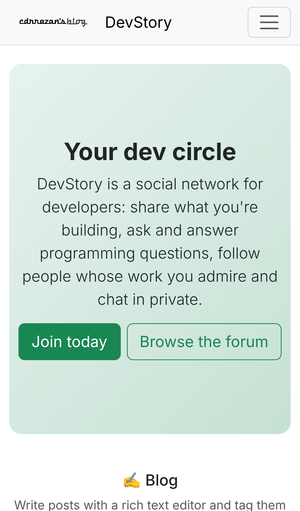<br><sub><b>On a phone</b></sub></td>
  </tr>
</table>

Screenshots are generated from the seed data by
[`script/screenshots.js`](script/screenshots.js).

## Tech stack

| Layer | Technology | Notes |
|---|---|---|
| Language | Ruby 4.0 | Any Ruby ≥ 3.3 works; CI tests 3.3, 3.4 and 4.0. |
| Framework | Rails 8.1 | `load_defaults 8.1`. |
| Database | MySQL 8.0 / 8.4 | `mysql2` adapter, utf8mb4, strict SQL mode; CI runs both versions. |
| Background jobs | Solid Queue | Own database (`<name>_queue`) in production; jobs retry on MySQL deadlocks. |
| Cache | Solid Cache | Own database (`<name>_cache`) in production. |
| WebSockets | Solid Cable | Own database (`<name>_cable`); connections authenticated with the Devise session. |
| Web server | Puma | Can run Solid Queue in-process (`SOLID_QUEUE_IN_PUMA`). |
| Front end | Turbo, Stimulus, import maps | No bundler and no Node.js. |
| Styling | Bootstrap 5.3, Dart Sass, Sprockets | Sprockets is kept for ActiveAdmin and the bootstrap gem. |
| Editor | Trix | Shipped by the `action_text-trix` gem. |
| Accounts | Devise 5 | Members and admins are separate models; Turbo-friendly 422/303 responses. |
| Authorization | Pundit | Policies in `app/policies`. |
| Uploads | Active Storage + libvips | Profile pictures with thumbnail/medium/large variants. |
| Admin | ActiveAdmin 3.5 | Ransack 4 search allowlists. |
| Social | acts_as_votable, acts-as-taggable-on, public_activity | Cached vote counts and tag lists on `posts`. |
| Recommendations | tf-idf-similarity | Stop-word filtered; see [doc/recommendations.md](doc/recommendations.md). |
| Tests | RSpec, FactoryBot, Shoulda Matchers, Capybara + Cuprite, SimpleCov | 100% line and branch coverage, enforced. |
| Quality | RuboCop (rails-omakase), Brakeman, bundler-audit, importmap audit | Run by `bin/ci` and GitHub Actions. |

## Architecture

### How a request flows

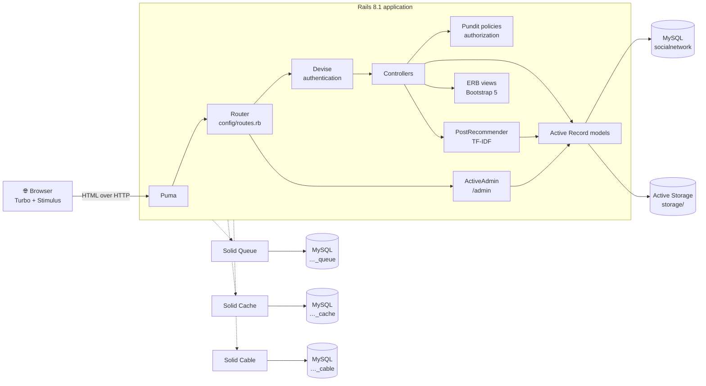

### Publishing a post

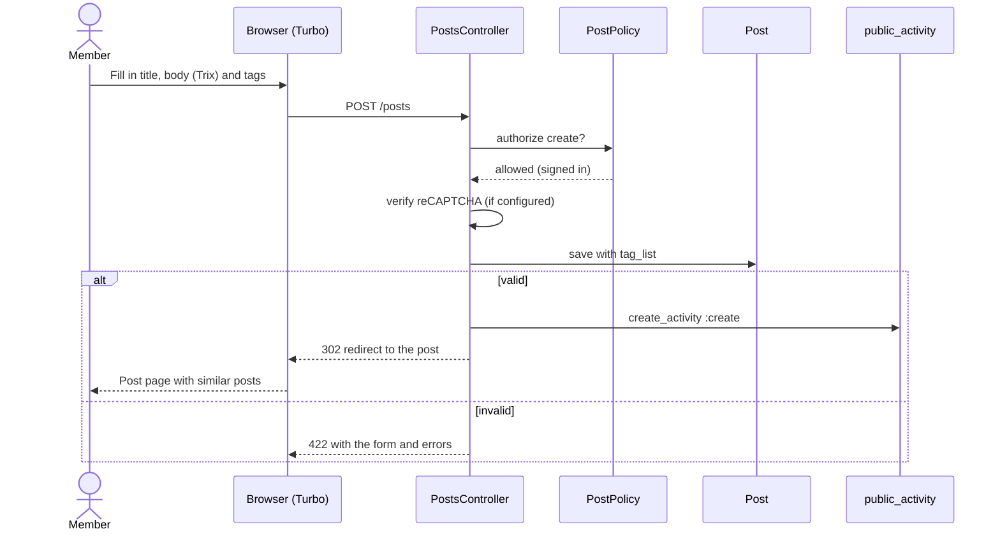

### Data model

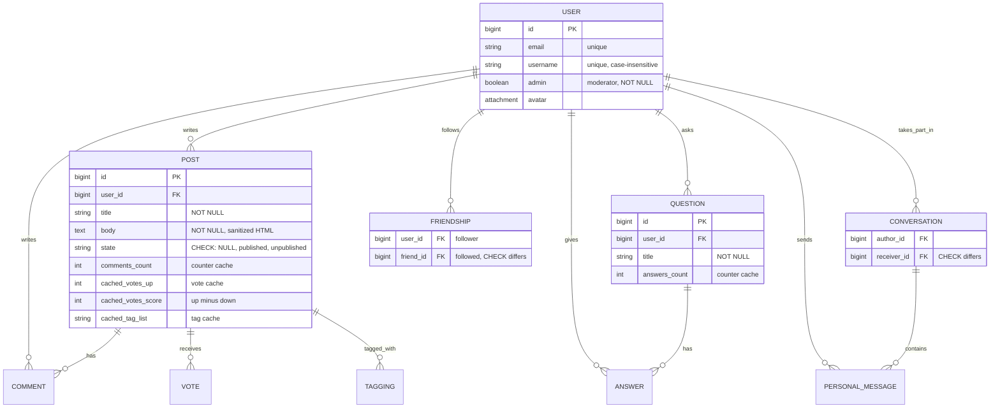

[doc/architecture.md](doc/architecture.md) has the full data model, including
the tables that gems add.

### Who can do what

| Resource | Read | Create | Edit | Delete |
|---|---|---|---|---|
| Post | Members (drafts: author and moderators) | Members | Author, moderators | Author, moderators |
| Comment | With its post | Members | Author | Author, moderators |
| Question | Everyone | Members | Author, moderators | Author, moderators |
| Answer | Everyone | Members | n/a | Author, moderators |
| Conversation | The two participants | Members | n/a | n/a |
| Admin panel | Admin users only (separate login) | | | |

A *moderator* is a member whose **admin** flag has been switched on in the
admin panel.

### Similar posts in one picture

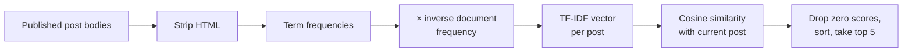

## Database

DevStory runs on **MySQL 8.0.16 or newer** (CI tests 8.0 and 8.4). The schema
enforces the same rules as the models, so bad data is rejected even when
validations are skipped:

| Rule | How MySQL enforces it |
|---|---|
| Every post, comment, question, answer and message has an author and content | `NOT NULL` columns |
| No comment, answer, follow or message points at a deleted row | Foreign keys on every reference |
| One account per username, whatever the case | Unique index with the case-insensitive `utf8mb4_unicode_ci` collation |
| You can't follow yourself or message yourself | `CHECK (user_id <> friend_id)`, `CHECK (author_id <> receiver_id)` |
| Posts are either published or drafts | `CHECK (state IS NULL OR state IN ('published', 'unpublished'))` |
| One follow and one conversation per pair of people | Unique composite indexes |
| Emoji and every other character can be stored | `utf8mb4` everywhere; tags use `utf8mb4_bin` |
| A 65,535-character post fits even in emoji | Body columns are `MEDIUMTEXT` (a `TEXT` column holds only 65,535 *bytes*) |

Lists don't need a `COUNT` per row: comment, answer and vote counts and each
post's tag list are cached on the row and kept up to date automatically.

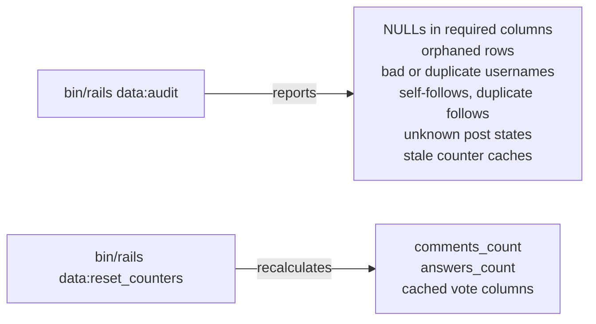

`data:audit` exits with status 1 when it finds problems, so it can run in CI
or before a deploy. It also works on an old 2017 database before migrating.
See [doc/UPGRADING.md](doc/UPGRADING.md).

## Getting started

### Requirements

| Tool | Version | Why |
|---|---|---|
| Ruby | 4.0 (≥ 3.3) | See [`.ruby-version`](.ruby-version). |
| MySQL | 8.0.16 or newer | The database. `brew install mysql` / `apt install mysql-server`, or Docker (below). |
| MySQL client headers | any | Needed to compile the `mysql2` gem (`libmysqlclient-dev` on Debian/Ubuntu; included with Homebrew's `mysql`). |
| libvips | any recent | Resizes profile pictures (`brew install vips` / `apt install libvips`). |
| Chrome or Chromium | any recent | System specs only. |

You don't need Node.js, Yarn or Redis.

### Setup

**1. Create the MySQL user** the app connects as (once per machine):

```bash
mysql -u root -p -e "CREATE USER IF NOT EXISTS 'socialnetwork'@'127.0.0.1' IDENTIFIED BY 'socialnetwork'; GRANT ALL PRIVILEGES ON \`socialnetwork\_%\`.* TO 'socialnetwork'@'127.0.0.1';"
```

No local MySQL? Start one in Docker instead (it creates the same user):

```bash
docker run -d --name devstory-mysql -p 3306:3306 -e MYSQL_ROOT_PASSWORD=root -v "$PWD/docker/mysql/init.sql:/docker-entrypoint-initdb.d/init.sql:ro" mysql:8.4
```

To use a different server or user, set `DB_HOST`, `DB_PORT`, `DB_USERNAME`
and `DB_PASSWORD` (see [Configuration](#configuration)).

**2. Set up and start the app:**

```bash
git clone https://github.com/cdrrazan/socialnetwork.git
cd socialnetwork
bin/setup
```

`bin/setup` installs the gems, creates `socialnetwork_development` and
`socialnetwork_test`, loads the schema and demo content from
[`db/seeds.rb`](db/seeds.rb), and starts the server at
**http://localhost:3000**. If it can't reach MySQL it prints what to fix.
Start the server again later with `bin/dev`.

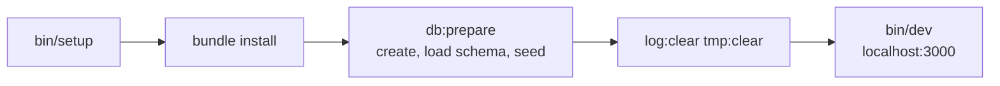

### Demo accounts

The seeds create these accounts, all with the password **`password`**:

| Account | Where to log in | Notes |
|---|---|---|
| `code@example.com` | http://localhost:3000/users/sign_in | Follows the other two members and has a conversation with `world`. |
| `world@example.com` | Same | |
| `rubynepal@example.com` | Same | |
| `admin@example.com` | http://localhost:3000/admin | Admin panel. |

Seeds are idempotent: run `bin/rails db:seed` at any time to restore them.
They never run in production unless you set `SEED_DEMO_DATA=true`, so a new
deployment doesn't get accounts with a known password.

## Configuration

Settings come from environment variables. In development and test you can
put them in a `.env` file (copy [`.env.example`](.env.example)); it is
ignored by git.

| Variable | Default | Purpose |
|---|---|---|
| `DB_HOST` | `127.0.0.1` | MySQL server. |
| `DB_PORT` | `3306` | MySQL port. |
| `DB_USERNAME` | `socialnetwork` | MySQL user. |
| `DB_PASSWORD` | `socialnetwork` (dev/test) | MySQL password. **Required in production.** |
| `DB_NAME` | `socialnetwork_production` | Production database name; Solid uses `<name>_cache`, `<name>_queue`, `<name>_cable`. |
| `DATABASE_URL` | unset | Full connection URL for the primary database; overrides the settings above. |
| `SECRET_KEY_BASE` | dev: auto-generated | **Required in production.** Generate with `bin/rails secret`. |
| `APP_HOST` | `example.com` | Host name used in links in emails (production). |
| `MAILER_FROM` | `DevStory <no-reply@APP_HOST>` | Sender of password-reset and other emails. |
| `RECAPTCHA_SITE_KEY`, `RECAPTCHA_SECRET_KEY` | unset | Turn on reCAPTCHA for new posts. Without them it is off. |
| `FORCE_SSL` | `true` | Set to `false` to serve production over plain HTTP. |
| `SOLID_QUEUE_IN_PUMA` | unset | Run background jobs inside Puma. |
| `SEED_DEMO_DATA` | unset | Set to `true` to allow `db:seed` in production. |
| `RAILS_MAX_THREADS` | `3` (DB pool: `5`) | Puma threads per process; also sets the database connection pool. |
| `WEB_CONCURRENCY` | unset | Number of Puma worker processes. |
| `PORT` | `3000` | Port Puma listens on. |
| `RAILS_LOG_LEVEL` | `info` | Production log level. |
| `BROWSER_PATH`, `HEADLESS` | unset | Chrome binary for system specs; `HEADLESS=false` shows the browser. |

## Testing and quality

The test suite is **RSpec** with FactoryBot, Shoulda Matchers and Capybara
(Cuprite drives Chrome for the JavaScript specs). Specs run against MySQL, in
transactions that are rolled back after each example.

```bash
bin/rspec                                  # everything: 448 examples, ~40 s
bin/rspec spec/models                      # one folder
bin/rspec spec/requests/posts_spec.rb:42   # one example
bin/ci                                     # lint, security scans, specs, seeds, data audit
```

A full `bin/rspec` run **fails if line or branch coverage drops below 100%**.
The HTML report is written to `coverage/index.html`. Running a subset only
reports coverage, so it never fails for that reason.

| Folder | Count | What it covers |
|---|---|---|
| `spec/models` | 117 | Associations, validations, scopes, callbacks, counter caches, votes, tags. |
| `spec/policies` | 45 | Every Pundit rule for owners, members, moderators and visitors. |
| `spec/services` | 30 | `PostRecommender` ranking and stop words; `DataAudit` against recreated 2017-style tables. |
| `spec/requests` | 147 | Every controller: sign-in redirects, authorization, strong params, 404s, Turbo status codes, JSON, sanitized HTML, query counts. |
| `spec/requests/admin` | 33 | ActiveAdmin access, dashboard, filters, Ransack allowlist, publishing, moderator flag. |
| `spec/system` | 19 | Real browser: sign-up/log-in, Trix, Turbo confirms, voting, sorting, comments, forum, follows, messages, avatar upload, mobile menu, admin publishing. |
| `spec/db` | 28 | MySQL constraints (NOT NULL, foreign keys, unique, CHECK, bigint, utf8mb4, MEDIUMTEXT bodies) and the seed file. |
| `spec/channels`, `spec/jobs`, `spec/mailers`, `spec/tasks` | 14 | Cable authentication, deadlock retries, mail sender, rake task output and exit codes. |
| `spec/factories_spec.rb` | 15 | Every factory and trait builds a valid record. |

Quality checks:

| Check | Command |
|---|---|
| 🎨 Style | `bin/rubocop` |
| 🔐 Code security | `bin/brakeman` (two reviewed false positives are documented in `config/brakeman.ignore`) |
| 📦 Gem security | `bin/bundler-audit` |
| 📦 JS security | `bin/importmap audit` |
| 🌱 Seeds | `RAILS_ENV=test bin/rails db:seed:replant` |
| 🗄️ Data | `bin/rails data:audit` |
| 🔁 Upgrade path | `script/rehearse_upgrade` (builds a 2017-style database, migrates it, compares with `db/schema.rb`) |

### Continuous integration

GitHub Actions ([`.github/workflows/ci.yml`](.github/workflows/ci.yml)) runs
on every push to `main`/`master` and on every pull request. Dependabot keeps
gems and actions up to date.

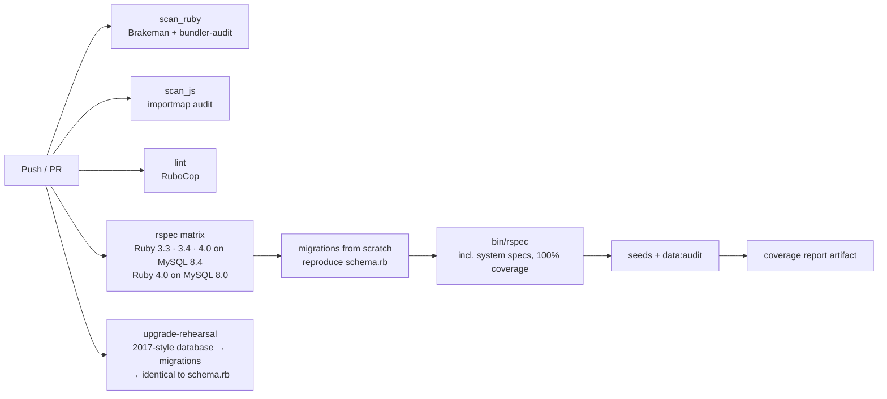

## Docker

The [`Dockerfile`](Dockerfile) builds a production image: multi-stage build,
Ruby 4.0 slim, the MySQL client library, jemalloc, libvips, a non-root user,
precompiled assets and bootsnap.
[`docker-compose.yml`](docker-compose.yml) runs it together with MySQL 8.4:

```bash
SECRET_KEY_BASE=$(bin/rails secret) docker compose up --build
```

Open http://localhost:3000. On first start the app creates its four databases
and loads the schema. MySQL data is kept in the `mysql` volume and uploads in
the `storage` volume. To add the demo content:

```bash
docker compose exec -e SEED_DEMO_DATA=true web bin/rails db:seed
```

## Deployment

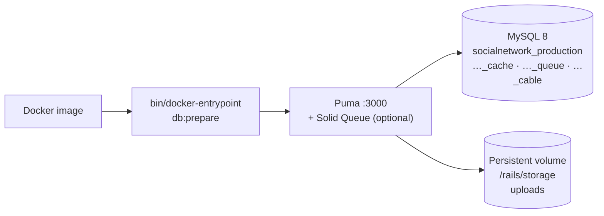

This is a standard Rails 8 app, so it runs on any container host or server
with Ruby and access to MySQL. Checklist:

1. **Create a MySQL user** that can create and use `socialnetwork_production`
   and the `_cache`, `_queue` and `_cable` databases next to it (see
   [`docker/mysql/init.sql`](docker/mysql/init.sql)). Set `DB_HOST`,
   `DB_USERNAME` and `DB_PASSWORD` (and `DB_NAME` to use another name).
2. **Set `SECRET_KEY_BASE`** and **`APP_HOST`**. Set `FORCE_SSL=false` only if
   TLS is not terminated in front of the app.
3. **Mount persistent storage** at `storage/` (`/rails/storage` in the image)
   for uploaded profile pictures.
4. **Migrations** run automatically when the container starts
   (`bin/rails db:prepare`). Demo seed data is never loaded in production.
5. **Background jobs**: run `bin/jobs` as a second process, or set
   `SOLID_QUEUE_IN_PUMA=true` on a single server.
6. **Create the first admin** from a console:
   ```ruby
   AdminUser.create!(email: "you@example.com", password: "a-long-password")
   ```
7. **Health check**: `GET /up` returns 200 when the app has booted.
8. **Optional**: run `bin/rails data:audit` after deploys to catch data
   problems early.

Upgrading an installation from the 2017 version? Read
[doc/UPGRADING.md](doc/UPGRADING.md) first.

## Routes

| Path | Page | Access |
|---|---|---|
| `/` | Landing page, or the blog when signed in | Everyone |
| `/about`, `/contact` | Static pages | Everyone |
| `/users/sign_up`, `/users/sign_in`, `/users/password/new` | Devise accounts | Everyone |
| `/users/edit` | Edit profile, password and picture | Members |
| `/posts`, `/posts?tag=ruby` | Blog, optionally filtered by tag | Members |
| `/posts/new`, `/posts/:id`, `/posts/:id/edit` | Write, read and edit posts | Members |
| `PUT /posts/:id/like`, `PUT /posts/:id/dislike` | Vote | Members |
| `/posts/:post_id/comments` | Add, edit and delete comments | Members |
| `/questions`, `/questions/:id` (also `.json`) | Forum | Everyone |
| `/questions/new`, `/questions/:id/edit` | Ask and edit questions | Members |
| `/questions/:question_id/answers` | Answer and delete answers | Members |
| `/users`, `/users/:id` | People search and profiles | Members |
| `/my_friends` | Following and followers | Members |
| `POST /friendships`, `DELETE /friendships/:user_id` | Follow and unfollow | Members |
| `/activities` | Activity feed | Members |
| `/conversations`, `/conversations/:id` | Private messages | Participants |
| `/personal_messages/new?receiver_id=:id` | Start a conversation | Members |
| `/profile`, `/settings` | Your profile; delete your account | Members |
| `/admin` | ActiveAdmin | Admin users |
| `/up` | Health check | Everyone |

Run `bin/rails routes` for the full list.

## Project layout

```text
app/
├── admin/            ActiveAdmin resources and dashboard
├── assets/           Sass (application.scss, active_admin.scss) and images
├── channels/         Action Cable connection (Devise-authenticated)
├── controllers/      Blog, forum, people, messaging, activity and static pages
├── javascript/       Import-map entry point and Stimulus controllers
├── jobs/             ApplicationJob (retries MySQL deadlocks)
├── mailers/          ApplicationMailer (also the parent of Devise's mailer)
├── models/           Active Record models
├── policies/         Pundit authorization policies
├── services/         PostRecommender (similar posts), DataAudit (data checks)
└── views/            ERB templates (Bootstrap 5)
config/               Routes, environments, MySQL database.yml, import map, Solid configs
db/
├── migrate/          Migrations from 2017 to today
├── schema.rb         Current MySQL schema
└── seeds.rb          Demo data (skipped in production)
docker/mysql/         init.sql creating the app's MySQL user
doc/
├── architecture.md   Data model, request flow, authorization
├── recommendations.md How "similar posts" works
├── UPGRADING.md      Migrating a 2017 installation
└── screenshots/      Images used in this README
lib/tasks/data.rake   data:audit and data:reset_counters
script/
├── rehearse_upgrade  Rehearses upgrading a 2017 database
└── screenshots.js    Regenerates the screenshots
spec/                 RSpec: models, policies, services, requests, admin,
                      system, db constraints, channels, jobs, mailers, tasks
├── factories/        FactoryBot factories and traits
└── support/          Capybara/Cuprite, Devise, query matchers, legacy tables
```

## Command cheat sheet

| Task | Command |
|---|---|
| Set up and start | `bin/setup` |
| Start the server | `bin/dev` |
| Rails console | `bin/rails console` |
| MySQL console for the app database | `bin/rails dbconsole` |
| Reload demo data | `bin/rails db:seed` |
| Reset the database | `bin/rails db:reset` |
| Run migrations | `bin/rails db:migrate` |
| Check data integrity | `bin/rails data:audit` |
| Rehearse upgrading a 2017 database | `script/rehearse_upgrade` |
| Fix counter caches | `bin/rails data:reset_counters` |
| Run every spec (with coverage) | `bin/rspec` |
| Run one spec file or line | `bin/rspec spec/models/post_spec.rb:42` |
| Watch system specs in a browser | `HEADLESS=false bin/rspec spec/system` |
| Run everything CI runs | `bin/ci` |
| Auto-fix style | `bin/rubocop -a` |
| Background jobs (production) | `bin/jobs` |
| Pin a JavaScript package | `bin/importmap pin <package>` |
| Regenerate screenshots | `node script/screenshots.js` |

## Further reading

- [doc/architecture.md](doc/architecture.md): data model, request flow,
  authorization and background jobs
- [doc/recommendations.md](doc/recommendations.md): the TF-IDF and cosine
  similarity maths behind "similar posts"
- [doc/UPGRADING.md](doc/UPGRADING.md): upgrading a 2017 MySQL installation
  in place
- [CHANGELOG.md](CHANGELOG.md): what changed in the 2026 rebuild

## Contributing

1. Fork the repository and create a branch.
2. Make your change, with tests.
3. Run `bin/ci` (or at least `bin/rspec` and `bin/rubocop`). Keep coverage at 100%.
4. Open a pull request. CI must pass.

If you change the UI, regenerate the screenshots with
`node script/screenshots.js`.

## Credits

Built in 2017 by the DevStory / Coders Sanjal team as a final-year project, and
modernised in 2026. See the git history for all contributors.
