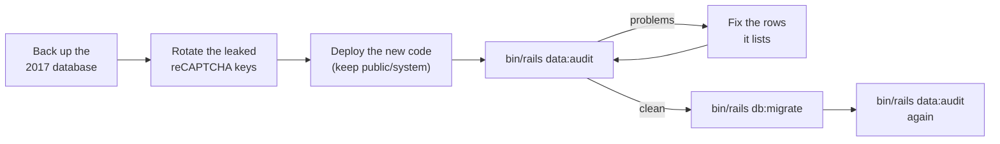

# Upgrading from the 2017 version

The 2026 revamp moved DevStory from Ruby 2.4 / Rails 5.0 to Ruby 4.0 /
Rails 8.1 and replaced several abandoned gems. **It still runs on MySQL**, so
an existing 2017 database is upgraded in place by the migrations. A fresh
install needs nothing special; see the [README](../README.md).

Every step below is rehearsed automatically: `script/rehearse_upgrade` (run
by `bin/ci` and on every pull request) builds a database the way a 2017
install looked, fills it with 2017-style data, runs these migrations and
checks the result is identical to a fresh install.



## 1. Back up

```bash
mysqldump --single-transaction --routines socialnetwork_production > devstory-2017.sql
```

Also keep a copy of `public/system/`, which holds the Paperclip profile
pictures.

## 2. Rotate leaked secrets

The old repository committed a `.env` file with live Google reCAPTCHA keys and
`config/secrets.yml` with development/test `secret_key_base` values. They have
been removed, but they remain in the git history. Generate new reCAPTCHA keys
in the [reCAPTCHA admin console](https://www.google.com/recaptcha/admin),
delete the old ones, and set the new ones as environment variables.

## 3. Point the app at the database

Connection settings now come from environment variables instead of
`config/database.yml`:

| 2017 `database.yml` | Now |
|---|---|
| `host: localhost` | `DB_HOST` (default `127.0.0.1`) |
| `username: socialnetwork` | `DB_USERNAME` (default `socialnetwork`) |
| `password: <%= ENV['SOCIALNETWORK_DATABASE_PASSWORD'] %>` | `DB_PASSWORD` |
| `database: socialnetwork_production` | `DB_NAME` (default `socialnetwork_production`) |

Production also uses three new databases on the same server for Solid Cache,
Solid Queue and Solid Cable: `<DB_NAME>_cache`, `<DB_NAME>_queue` and
`<DB_NAME>_cable`. Give the app's user rights to create them:

```sql
GRANT ALL PRIVILEGES ON `socialnetwork\_%`.* TO 'socialnetwork'@'%';
```

MySQL 8.0.16 or newer is required (the first version that enforces CHECK
constraints). If you're still on MySQL 5.7, upgrade the
server first.

## 4. Audit the data

The new schema adds NOT NULL, foreign key, unique and CHECK constraints. Rows
that break them would make the migrations stop half-way, so check first:

```bash
bin/rails data:audit
```

It lists every problem with a few example ids, and exits with status 1 if
there are any:

```text
Found 2 problem(s):
- comments.post_id points to a missing post: 3 (e.g. ids 41, 87, 90)
- accounts sharing a username (case-insensitive): 2 (e.g. ids 12, 31)
```

| Problem | What to do |
|---|---|
| `… is empty` | Fill in or delete those rows. |
| `… points to a missing …` | Delete the orphaned rows (their post, user or question is gone). |
| accounts sharing a username | Rename one account; usernames are unique regardless of case. |
| usernames with other characters | Rename to letters, numbers, `_`, `.` and `-` only. |
| users following themselves / conversations with yourself | Delete those rows. |
| duplicate follows | Keep one row per `user_id`/`friend_id` pair. |
| posts with an unknown state | Set `state` to `NULL` (published) or `unpublished`. |

"Users without a username" is reported but doesn't block the migrations.
Those members can still log in and will be asked for a username the next time
they edit their profile.

For example, to delete orphaned comments:

```sql
DELETE FROM comments
WHERE user_id NOT IN (SELECT id FROM users)
   OR post_id NOT IN (SELECT id FROM posts);
```

## 5. Migrate

```bash
bin/rails db:migrate
```

These migrations run on a 2017 database, in order:

| Migration | What it does |
|---|---|
| `CreateActiveStorageTables` | Adds the Active Storage tables. |
| `MigratePaperclipUserImagesToActiveStorage` | Copies each profile picture from `public/system/users/user_images/…/original/` into Active Storage, then drops the `user_image_*` columns. Missing files are skipped. |
| `TidyUpLegacySchema` | Drops the unused `relationships` table and `answers.post_id`, adds indexes and foreign keys, and a unique index on `users.username`. |
| `UpgradeSchemaForMysql` | Widens every key to `BIGINT`, adds `NOT NULL` to required columns, switches to microsecond timestamps, adds counter caches (back-filled from existing rows), CHECK constraints and indexes, and drops the unused `posts.slug`. Stops with a clear message if a required column still has NULLs. |
| `AddCachedTagListToPosts` | Caches each post's tag list on the post (back-filled), so the blog index doesn't query tags per post. |
| `ConvertLegacyTablesToUtf8mb4` | Converts the 2017 `utf8` (3-byte) tables to `utf8mb4` so emoji work, and makes body columns `MEDIUMTEXT` so 65,535-character posts fit. |

On a database with tens of thousands of rows this takes seconds to minutes:
each table is rewritten a few times. Plan a short maintenance window.

Then run `bin/rails data:audit` again; it should report nothing (or only
members without usernames).

## 6. Behaviour changes

- **Post bodies** were written in the Froala editor, which has been replaced by
  Trix. Existing HTML is still displayed, but it is now passed through Rails'
  `sanitize`, so scripts, inline event handlers and unusual tags are removed.
- **Answers** now belong to questions. Under Rails 5 answers silently failed to
  save, because they were declared as belonging to a post.
- **Authorization** is enforced everywhere with Pundit. Previously anyone could
  delete any answer or comment by crafting a request.
- **Moderators**: the `users.admin` flag (editable in the admin panel) now lets
  a member edit or delete anyone's posts and questions and delete comments
  and answers.
- **Drafts** created in the admin panel are visible only to their author and
  moderators until published.
- **Tags** are stored lowercase, and tags no post uses any more are deleted.
- **Activity feed**: entries are recorded for new posts and comments again.
  Nothing was recorded before, so the feed starts empty.
- **Landing page**: the static `public/index.html` page has been replaced by a
  Rails view. Signed-in members go straight to the blog.
- **reCAPTCHA** on new posts is enabled automatically when
  `RECAPTCHA_SITE_KEY`/`RECAPTCHA_SECRET_KEY` are set.
- **Following** uses `POST /friendships` instead of `POST /add_friends`.
- **Emails** are sent from `MAILER_FROM` (default `DevStory <no-reply@APP_HOST>`).
- **Demo seed data** is never loaded in production unless `SEED_DEMO_DATA=true`.

## 7. Gem replacements

| Old | New |
|---|---|
| paperclip | Active Storage + image_processing |
| cancan | pundit |
| state_machine | plain scopes (`Post.published`/`unpublished`, `Post#publish!`) |
| turbolinks, jquery_ujs | turbo-rails, stimulus-rails |
| coffee-rails, uglifier | import maps (no compilation) |
| wysiwyg-rails (Froala) | Trix |
| bootstrap 4.0.0.alpha | bootstrap 5.3 |
| mysql2 0.4 | mysql2 0.5 |
| redis (Action Cable) | solid_cable |
| thin, spring | puma, bootsnap |
| byebug, pry, better_errors | debug |
| Minitest scaffold tests | RSpec, FactoryBot, Shoulda Matchers, Cuprite, SimpleCov |
| railroady, rails-erd | Mermaid diagrams in `doc/architecture.md` |
