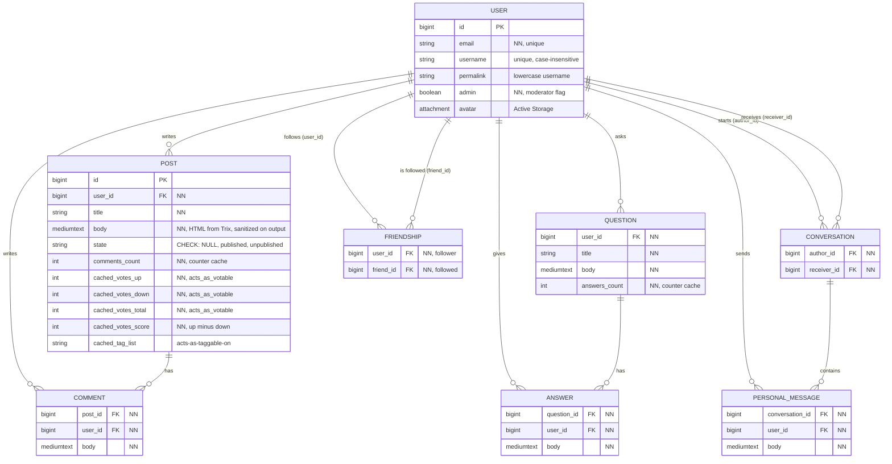
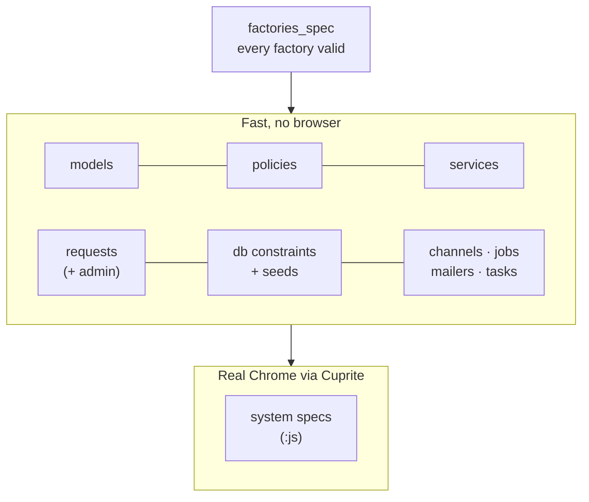

# Architecture

DevStory is a server-rendered Rails 8.1 application. Pages are ERB templates
styled with Bootstrap 5; Turbo makes navigation and form submissions feel
instant, and a few Stimulus controllers add behaviour where needed. There is
no separate front-end build: JavaScript is served through import maps, and
CSS is compiled by Sprockets with Dart Sass.

## Data model

All tables use MySQL's `utf8mb4` character set with `bigint` keys. Columns
marked *NN* are `NOT NULL`; *FK* columns have foreign key constraints.

Tables provided by gems are not shown:

- `votes` (acts_as_votable): up/down votes on posts.
- `tags`, `taggings` (acts-as-taggable-on): post tags. Tag names are stored
  lowercase and compared with the case-sensitive `utf8mb4_bin` collation.
- `activities` (public_activity): the activity feed. A row is written when a
  member publishes a post or comments.
- `active_storage_*`: profile picture uploads.
- `admin_users`: ActiveAdmin accounts, a separate Devise model from members.
- `active_admin_comments`: present but unused (admin comments are disabled).

### Constraints and indexes

| Table | Constraint or index | Purpose |
|---|---|---|
| `users` | unique `username` (`utf8mb4_unicode_ci`) | One account per username, whatever the case. |
| `friendships` | unique (`user_id`, `friend_id`); `CHECK (user_id <> friend_id)` | One follow per pair; no self-follows. |
| `conversations` | unique (`author_id`, `receiver_id`); `CHECK (author_id <> receiver_id)` | One conversation per pair; none with yourself. |
| `posts` | `CHECK (state IS NULL OR state IN ('published', 'unpublished'))` | Only known states. |
| `posts` | index (`state`, `created_at`) | Blog index: published posts, newest first. |
| `questions` | index `created_at` | Forum index, newest first. |
| `activities` | index (`owner_type`, `owner_id`, `created_at`) | Activity feed of the people you follow. |

The models validate the same rules, so members see friendly error messages;
the database is the backstop for anything that skips validations.
`spec/db/schema_constraints_spec.rb` proves each constraint by bypassing the
models.

### Keeping data healthy

`DataAudit` (`app/services/data_audit.rb`, run with `bin/rails data:audit`)
reports rows that break these rules: empty required columns, orphaned rows,
missing/invalid/duplicate usernames, self-follows, duplicate follows, unknown
post states and drifted counter caches. It skips checks for columns that don't
exist yet, so it also works on a 2017 database before migrating.
`bin/rails data:reset_counters` recalculates the counter caches.

## Request flow

| Area            | Controller(s)                                   | Notes                                                              |
| --------------- | ----------------------------------------------- | ------------------------------------------------------------------ |
| Landing/static  | `StaticController`                              | Signed-out root, about, contact, profile, settings.                |
| Blog            | `PostsController`, `CommentsController`         | Signed-in only. Signed-in root is the blog.                        |
| Forum           | `QuestionsController`, `AnswersController`      | Reading is public; writing needs an account. Also serves JSON.     |
| People          | `UsersController`, `FriendshipsController`      | Search, profiles, follow/unfollow.                                 |
| Activity feed   | `ActivitiesController`                          | Activities owned by people you follow.                             |
| Messaging       | `ConversationsController`, `PersonalMessagesController` | One conversation per pair of members.                      |
| Accounts        | Devise                                          | Sign up, log in, password reset, profile and avatar editing.       |
| Admin           | ActiveAdmin (`app/admin`)                       | Separate login at `/admin`.                                        |
| Health check    | `Rails::HealthController`                       | `GET /up`.                                                         |

## Authorization

Pundit policies live in `app/policies`. Each controller calls `authorize` on
the record it acts on; a failed check redirects back with an alert.

| Resource     | Read                 | Create    | Update        | Delete               |
| ------------ | -------------------- | --------- | ------------- | -------------------- |
| Post         | signed-in members    | members   | author, moderators | author, moderators |
| Comment      | (with post)          | members   | author        | author, moderators   |
| Question     | everyone             | members   | author, moderators | author, moderators |
| Answer       | everyone             | members   | n/a           | author, moderators   |
| Conversation | participants only    | members   | n/a           | n/a                  |

"Moderators" are members whose `admin` flag is set, which admins can toggle
in the admin panel.

## Recommendations

`PostRecommender` (`app/services/post_recommender.rb`) ranks published posts
by TF-IDF cosine similarity to the post being read, ignoring common English
stop words. It scores the whole corpus
on each request, which is fine at this app's scale; precompute similarities in
a background job if the number of posts grows large. See
[recommendations.md](recommendations.md) for the maths.

## Background jobs, caching and Action Cable

Production uses the Rails 8 "Solid" adapters, each with its own MySQL
database on the same server (`<DB_NAME>_queue`, `<DB_NAME>_cache` and
`<DB_NAME>_cable`; see `config/database.yml`):

- Solid Queue for Active Job (e.g. Active Storage analysis). Run `bin/jobs`, or
  set `SOLID_QUEUE_IN_PUMA=true`. `ApplicationJob` retries jobs that hit a
  MySQL deadlock and discards jobs whose records were deleted.
- Solid Cache for `Rails.cache`.
- Solid Cable for Action Cable / Turbo Streams. WebSocket connections are
  authenticated with the member's Devise session
  (`ApplicationCable::Connection`).

Development uses the in-memory cache and async adapters.

## Tests

The RSpec suite in `spec/` runs against MySQL and covers 100% of lines and
branches (enforced by SimpleCov on a full run). Specs are organised by type:

`script/rehearse_upgrade` complements the suite: it builds a database the way
a 2017 install looked, runs the migrations against 2017-style data and checks
the result is identical to `db/schema.rb`.
