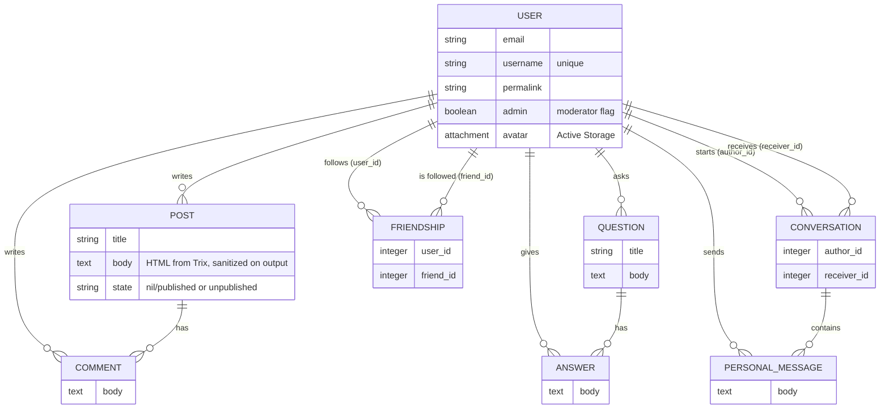

# Architecture

DevStory is a server-rendered Rails 8.1 application. Pages are ERB templates
styled with Bootstrap 5; Turbo makes navigation and form submissions feel
instant, and a few Stimulus controllers add behaviour where needed. There is
no separate front-end build: JavaScript is served through import maps, and
CSS is compiled by Sprockets with Dart Sass.

## Data model

Tables provided by gems are not shown:

- `votes` (acts_as_votable): up/down votes on posts.
- `tags`, `taggings` (acts-as-taggable-on): post tags.
- `activities` (public_activity): the activity feed. A row is written when a
  member publishes a post or comments.
- `active_storage_*`: profile picture uploads.
- `admin_users`: ActiveAdmin accounts, a separate Devise model from members.
- `active_admin_comments`: present but unused (admin comments are disabled).

## Request flow

| Area            | Controller(s)                                   | Notes                                                              |
| --------------- | ----------------------------------------------- | ------------------------------------------------------------------ |
| Landing/static  | `StaticController`                              | Signed-out root, about, contact, profile, settings.                |
| Blog            | `PostsController`, `CommentsController`         | Signed-in only. Signed-in root is the blog.                        |
| Forum           | `QuestionsController`, `AnswersController`      | Reading is public; writing needs an account. Also serves JSON.     |
| People          | `UsersController`, `FriendshipsController`      | Search, profiles, follow/unfollow.                                 |
| Activity feed   | `ActivitiesController`                          | Activities owned by people you follow.                             |
| Messaging       | `ConversationsController`, `PersonalMessagesController` | One conversation per pair of members.                      |
| Accounts        | Devise                                          | Sign up, log in, password reset, profile and avatar editing.       |
| Admin           | ActiveAdmin (`app/admin`)                       | Separate login at `/admin`.                                        |
| Health check    | `Rails::HealthController`                       | `GET /up`.                                                         |

## Authorization

Pundit policies live in `app/policies`. Each controller calls `authorize` on
the record it acts on; a failed check redirects back with an alert.

| Resource     | Read                 | Create    | Update        | Delete               |
| ------------ | -------------------- | --------- | ------------- | -------------------- |
| Post         | signed-in members    | members   | author, moderators | author, moderators |
| Comment      | (with post)          | members   | author        | author, moderators   |
| Question     | everyone             | members   | author, moderators | author, moderators |
| Answer       | everyone             | members   | n/a           | author, moderators   |
| Conversation | participants only    | members   | n/a           | n/a                  |

"Moderators" are members whose `admin` flag is set, which admins can toggle
in the admin panel.

## Recommendations

`PostRecommender` (`app/services/post_recommender.rb`) ranks published posts
by TF-IDF cosine similarity to the post being read. It scores the whole corpus
on each request, which is fine at this app's scale; precompute similarities in
a background job if the number of posts grows large. See
[recommendations.md](recommendations.md) for the maths.

## Background jobs, caching and Action Cable

Production uses the Rails 8 "Solid" adapters, each with its own SQLite
database under `storage/`:

- Solid Queue for Active Job (e.g. Active Storage analysis). Run `bin/jobs`, or
  set `SOLID_QUEUE_IN_PUMA=true`.
- Solid Cache for `Rails.cache`.
- Solid Cable for Action Cable / Turbo Streams.

Development uses the in-memory cache and async adapters.
